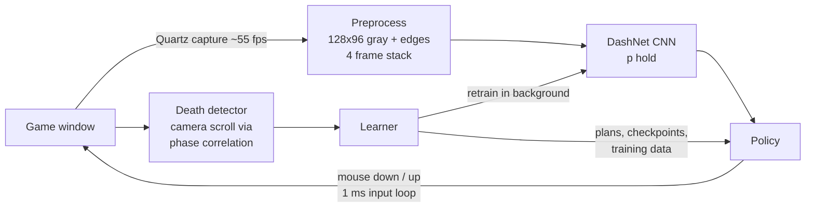

# gd-neural-player

A bot that learns to play **Geometry Dash** from the screen, the same way you do: it watches the window, decides when to hold the button, and gets better every time it dies.

No memory reading, no mods, no hooks into the game. Just pixels in, mouse clicks out.

Built and tested mainly on **Geometry Dash Meltdown** (the free iOS version running natively on an Apple Silicon Mac). Capture, death detection, the net, recording and plan learning don't care which version you run, so the full game on Steam works too with enough training. The practice-mode menu and checkpoint button positions were measured on Meltdown's layout and may need adjusting.

---

## How it works



### Seeing the game
- Grabs just the game window with Quartz at 1x resolution (no retina pixels) in its own thread, so capture overlaps with everything else. That plus some cheap preprocessing tweaks took the loop from ~37ms to ~18ms per frame.
- Frames get shrunk to 128x96 grayscale and mixed with Canny edges. GD recolors levels constantly but the outlines stay the same, so edges make the net a lot less sensitive to color changes.
- 4 frames are stacked so the net can see motion and vertical speed.

### Knowing when you died (without reading memory)
While you're alive the level scrolls left at a steady speed. When you die the camera freezes. So the bot measures horizontal scroll between frames with phase correlation:

- scroll stops for ~0.2s -> **died**
- camera snaps back in one frame (a ~47px jump at detection resolution) -> **respawned**, and that exact frame becomes the time zero for the attempt

No progress bar or text reading needed. The snap is what makes timing reliable: attempts that start without a visible snap (like when the bot is launched mid-run) are played but never trusted for learning.

### The net
`DashNet` is a small CNN (4 conv layers + MLP, ~1.3M params) with one output: probability of holding the button. It trains on Apple's MPS backend in a background thread after every death, and the new weights get swapped in on the next respawn.

### Learning a level
Pure random exploration was hopeless (hundreds of attempts to get past the first few spikes), so the learner leans on how GD actually works:

- **The game is deterministic.** Tapping at the same time after spawn gives the same death time every attempt, within about 20ms (`gdbot.timing_test` checks this). So the fix for a death is almost always one input in the half second before it.
- **Frontier search.** The bot keeps a *plan*, the exact press/release times of its furthest run. Each attempt replays the plan up to just before where it died, then tries something new.
- **GD-aware grid search** instead of random noise. Cube sections need a tap at the right moment, usually 0.2 to 0.4s before the obstacle, so those lead times get tried first. Ship and wave sections need holds of different lengths, so if the plan has long holds right before the death, a grid of hold start times and lengths goes first instead. ~25 candidates max per obstacle.
- **Practice mode checkpoints.** Once the plan gets a few seconds past the last checkpoint, the bot drops a new one at a spot it already knows it survives (it clicks the checkpoint button itself). Old sections never get replayed again, so every section costs about the same no matter how far into the level it is.
- **Patching.** If a replay keeps dying at the same spot, the bot re-explores only a ~0.7s window before it and splices the fix into the plan.
- **Backing off.** Stuck for a while, it explores earlier. Still stuck, it removes the last checkpoint and goes back a segment.
- Every frame it survived (minus the last half second before each death) becomes training data for the CNN.

### Learning from you
`gdbot.record` logs your own play: frames + what you were holding, plus your furthest run as a timed plan. Behavior cloning off a few minutes of human play gets the net to ~80% frame accuracy, and your run gives the learner a big head start.

---

## Things that bit me (and the fixes)

| Problem | What was happening | Fix |
| --- | --- | --- |
| Capture returned my wallpaper | macOS Screen Recording permission | Grant it to the terminal. Documented below. |
| Bot "died" constantly at the same spot | Practice mode's **Auto-Checkpoints** setting was on, so respawns happened at checkpoints the bot didn't know about | Turn it off, the bot places its own |
| Most deaths went undetected | The **Faster Reset** option respawns before the camera stall is long enough to register | Leave Faster Reset off |
| Plans replayed fine once, then failed | First attempt after launch started mid run, so its time base was off | Only trust attempts that start with a camera snap |
| 2 frame taps sometimes vanished on replay | Sampling the plan per frame can skip a short tap entirely | Replay by press/release events, a press is never dropped |
| Taps right before landing were coin flips | GD ignores taps in the air unless the button is still down on landing | Minimum hold of 100ms on every press |
| Every press was 0 to 18ms late | Inputs only went out when a new frame arrived | Separate ~1ms input loop, frames stamped with their capture time |
| Esc in other apps stopped the bot | Global key check | Esc only counts while the game is in front |

---

## Results

- Gets through roughly the first minute of **The Seven Seas** in practice mode, placing its own checkpoints along the way.
- Starting from a recorded human run it picks up from where you got to instead of from zero.
- **Not yet:** clean full clears in normal mode. Plans are timed from the respawn, and capture plus input jitter (±1 game frame) is enough to break the tightest jumps on some replays. The patch step covers part of that, the rest is what the next step on the roadmap is for.

---

## Setup (macOS, Apple Silicon)

```bash
git clone https://github.com/tristedw/gd-neural-player.git
cd gd-neural-player
uv venv -p python3.12 .venv
uv pip install -p .venv/bin/python -r requirements.txt
```

Give your terminal app these in **System Settings > Privacy & Security**, then restart it:
- **Screen Recording** (without it you capture your wallpaper)
- **Accessibility** (to send clicks)

In the game's settings:
- Practice tab: **Auto-Checkpoints off**
- Gameplay tab: **Faster Reset off**

Sanity check, play a bit while this runs. You should see `dx` jump while moving and `died` / `respawned` events:

```bash
.venv/bin/python -m gdbot.probe --seconds 15
```

## Usage

Everything stops with **Esc** while the game is focused, and saves on the way out.

```bash
# 1. optional but recommended: record yourself in normal mode
.venv/bin/python -m gdbot.record --level seven_seas

# 2. train the net on everything recorded so far
.venv/bin/python -m gdbot.train --level seven_seas --epochs 10

# 3. let it learn the level in PRACTICE mode
./run.sh seven_seas --learn
./run.sh seven_seas --learn --resume     # continue, game checkpoints still placed
./run.sh seven_seas --learn --rebuild    # fresh practice run, re-places saved checkpoints first

# 4. play it in normal mode
./run.sh seven_seas --policy net         # pure neural net
./run.sh seven_seas --policy plan        # replay the learned run
./run.sh seven_seas --learn --polish     # replay the learned run and patch where it fails
```

Other tools:

```bash
.venv/bin/python -m gdbot.timing_test 0.25,0.30,0.35,0.35,0.35   # how repeatable is input timing
.venv/bin/python -m tests.test_offline                           # unit checks, no game needed
```

Output lands in `models/<level>.pt`, `models/<level>_plan.json`, `models/<level>_practice.json` and `data/<level>/`.

## Project layout

```
gdbot/
  window.py       find the game window, threaded Quartz capture
  controls.py     mouse down/up into the game, min hold, reading your input
  vision.py       preprocessing, frame stack, death/respawn detection
  model.py        DashNet CNN
  data.py         npz training chunks
  train.py        behavior cloning / retraining
  play.py         main loop: plans, grid search, checkpoints, patching, background learner
  record.py       record human play as training data + a plan
  probe.py        debug fps / scroll / death events
  timing_test.py  input timing repeatability check
tests/
  test_offline.py death detector on a fake scrolling level, model + train pass
```

## Roadmap

- **Geode bridge for the full game.** Every bot that reliably clears levels runs as a game mod: exact player state, frame-perfect input, and a speed multiplier so training runs much faster than realtime. Swapping the screen capture + clicker for a small Geode mod would keep the CNN and learner as-is and remove the timing jitter completely.
- Index plans by camera distance (integrated scroll) instead of time, to cut out the remaining jitter on screen-only setups.
- Detect the game mode (cube, ship, ball, UFO, wave, robot) from the player sprite so the grid search picks the right candidates directly.

## License

MIT
